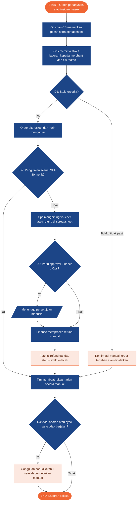
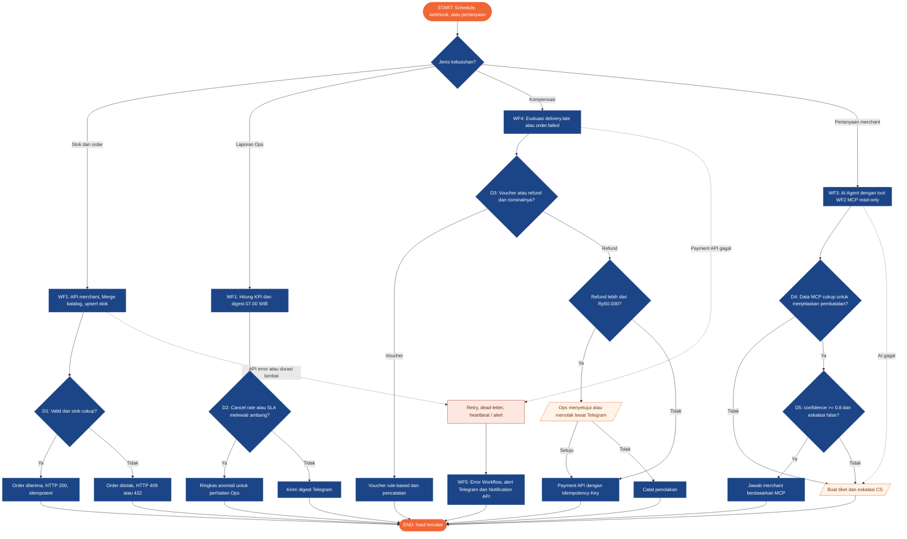

# 01 · BRD Ringkas + Process Map As-Is / To-Be · H8Mart Quick-Commerce Ops

**Nama:** Yusuf Baihaqi Amanda
**Proyek:** Hacktiv8 AI Engineer · Phase 3 Milestone 3
**Status dokumen:** Rancangan solusi berdasarkan skenario mentor dan implementasi WF1–WF5 yang diuji pada 15 November 2026.

## 1. BRD Ringkas

**Konteks bisnis.** H8Mart merupakan quick-commerce fiktif tanpa gudang sendiri, dengan 12 merchant di tiga zona (Jakarta Selatan, Tangerang, Bekasi). Pemenuhan pesanan bergantung pada data stok merchant; target pengalaman pengantaran sekitar 30 menit. Sistem diimplementasikan sebagai lima workflow n8n pada AWS EC2 dengan HTTPS, PostgreSQL, Mock API, Telegram, dan Uptime Kuma.

| Item | Isi | Sumber |
| --- | --- | --- |
| Masalah bisnis 1 — stok | Merchant Stock API kadang lambat atau gagal diam-diam; stok aplikasi tidak sesuai stok merchant sehingga order barang habis tetap masuk. | `README.md` §1 Skenario, masalah 1 |
| Masalah bisnis 2 — SLA dan kompensasi | Keterlambatan terhadap SLA ±30 menit memerlukan voucher, tetapi prosesnya masih manual melalui spreadsheet. | `README.md` §1 Skenario, masalah 2 |
| Masalah bisnis 3 — refund | Refund atas order gagal diproses manual oleh finance dan berisiko terproses dua kali. | `README.md` §1 Skenario, masalah 3 |
| Masalah bisnis 4 — layanan merchant | CS menarik KPI, alasan pembatalan, dan stok secara manual ketika merchant bertanya; jawaban menjadi lambat dan tidak konsisten. | `README.md` §1 Skenario, masalah 4 |
| Masalah bisnis 5 — reliability | Kegagalan laporan harian atau sinkronisasi stok tidak selalu terlihat oleh tim Ops. | `README.md` §1 Skenario, masalah 5 |
| Tujuan & ukuran keberhasilan | Sinkron stok terjadwal **15 menit**, digest **07.00 WIB**, order stok cukup **HTTP 200**, stok tidak cukup **HTTP 409**, payload tidak valid **HTTP 422**; upsert dan refund idempotent; error masuk dead-letter/alert; pertanyaan merchant menggunakan data MCP atau tiket CS. Target layanan pengiriman **≤30 menit**. | `README.md` §1 Hasil akhir; hasil uji AWS WF1–WF5 (`evidence/`) |
| Stakeholder & actor | Pelanggan, merchant (12 mitra), kurir, tim Operations, Customer Service, Finance, approver Ops, administrator sistem. | `README.md` §1 Skenario; alur approval dan eskalasi WF3/WF4 |
| Volume & frekuensi | **12 merchant / 3 zona**, sinkron tiap **15 menit**, digest tiap **07.00 WIB**; order dan kompensasi berbasis event. Volume order harian aktual tidak diasumsikan sebagai baseline tetap. | `README.md` §1 dan §3; konfigurasi WF1 |
| Aturan bisnis BR1 — validasi order | Payload `order.created` harus valid; cek stok berdasarkan merchant dan SKU. Jika cukup/tipis, terima; jika kurang, tolak; identitas order yang sama tidak dibuat dua kali. | WF1: `Event Valid?`, `Cek Stok Order`, `Routing Stok`, `Catat Order`; evidence WF1 |
| Aturan bisnis BR2 — kompensasi | Keterlambatan ditangani dengan voucher sesuai aturan WF4; refund memakai idempotency key; refund bernilai besar memerlukan persetujuan Ops, tanpa otomatis mengklaim berhasil jika Payment API gagal. Ambang nominal mengikuti konfigurasi WF4, bukan ditetapkan ulang dalam dokumen ini. | `README.md` §1 Hasil akhir; WF4; evidence WF4 |
| Aturan bisnis BR3 — jawaban AI | AI hanya menyatakan data operasional yang didukung MCP; jawaban otomatis mensyaratkan `confidence ≥ 0,8` dan `perlu_eskalasi = false`; selebihnya tiket CS. | WF2–WF3: `AI Merchant Assistant`, `Lolos Guardrail?`, `Buat Tiket CS`; evidence WF3 |
| Aturan bisnis BR4 — reliability | Merchant gagal setelah retry dicatat ke dead-letter, merchant lain tetap diproses; sinyal monitoring `UP/DOWN` mencerminkan hasil sinkronisasi; error workflow memberi alert. | WF1, WF5; evidence WF1/WF5 |
| Dalam scope automasi | Sinkron stok, pemeriksaan dan pencatatan order, digest, chatbot AI dengan tiga MCP tool baca-saja, voucher/refund beserta approval, logging error dan monitoring. | `README.md` §3 Sistem yang harus dibangun; WF1–WF5 |
| Di luar scope (saat ini) | Gateway pembayaran riil, perubahan stok merchant pada sistem sumber, login/otorisasi merchant per pengguna, integrasi WhatsApp, penyelesaian tiket CS oleh manusia, sistem pengiriman riil. | Batasan Mock API dan workflow yang dibangun; `README.md` §3 eksplorasi opsional |

**Bukti implementasi terukur (bukan baseline bisnis umum).** Dalam pengujian AWS: stock sync pertama memproses **11/12 merchant**, mencatat kegagalan M009 dan **188 baris tersinkron**; tabel stok berisi **205 pasangan merchant–produk** tanpa duplikasi dan tetap 205 setelah sync kedua. Order Intake mengembalikan 200/409/422 sesuai skenario, serta hanya satu order untuk event duplikat. WF3 berhasil menjawab KPI, stok, dan alasan pembatalan dengan MCP, dan mencatat tiket CS ketika permintaan tidak dapat ditangani otomatis. WF4 diuji untuk approve/reject/auto-refund/duplikat/payment failure; WF5 mengirim alert Telegram dan mencatat notifikasi Mock API. Rincian berada di folder `evidence/`.

## 2. Process Map As-Is (proses manual sebelum automasi)

> Diagram ini merekonstruksi kondisi manual dari cerita skenario mentor; bukan hasil observasi langsung sistem perusahaan nyata.

## 3. Process Map To-Be (automasi WF1–WF5)

> Kode **D1–D5** dipakai konsisten pada tabel keputusan di `docs/02-desain-solusi-roi.md`. AI ditandai **A1**, manusia **H1/H2**, dan jalur pengecualian **EX**. **D2 adalah pemeriksaan analitis yang diusulkan, bukan klaim bahwa alert threshold cancel rate/SLA sudah diimplementasikan**; workflow saat ini mengirim KPI dalam digest dan memiliki alert perlambatan sinkronisasi yang terpisah.

**Catatan operasional:** Jadwal sinkronisasi 15 menit dan digest 07.00 telah dikonfigurasi serta diuji; kedua Schedule Trigger dinonaktifkan setelah pengambilan evidence untuk mencegah notifikasi berulang selama penilaian, sementara webhook production tetap Published. Aktifkan kembali bila evaluasi meminta demonstrasi jadwal. Status monitor Uptime Kuma `DOWN` pada uji parsial M009 merupakan hasil deteksi yang diharapkan, bukan bukti seluruh stack mati.

## 4. Tabel Translasi ke Automation Flow

| Kode | Langkah manual (as-is) | Elemen automation flow (n8n) | Nama node / workflow | Alasan (bukan sekadar mengulang nama node) |
| --- | --- | --- | --- | --- |
| P1 | Ops mengecek stok merchant satu per satu | Schedule, HTTP Merchant Stock API, loop, Code, Merge, Postgres upsert | WF1: `Jadwal Sinkron 15 Menit`, `Loop Per Merchant`, `Ambil Stok Merchant API`, `Normalisasi Stok`, `Upsert Stok` | Memperbarui data merchant secara berkala, mempertahankan merchant yang sehat ketika satu API gagal, dan menghindari baris ganda. |
| D1 | CS/Ops menanyakan ulang ketersediaan barang saat order masuk | Webhook, IF validasi, SQL stok, Switch, respons HTTP | WF1: `Webhook Order Created`, `Event Valid?`, `Cek Stok Order`, `Routing Stok`, `Catat Order` | Keputusan stok deterministik, cepat, dan dapat diaudit berdasarkan merchant serta SKU; 200/409/422. |
| P2 | Tim membuat laporan pagi secara manual | Schedule, SQL KPI dan alasan pembatalan, Code, Telegram, Notification API | WF1: `Jadwal Digest 07.00 WIB`, `Hitung KPI Harian`, `Alasan Batal Teratas`, `Tambah Alasan ke Digest`, `Kirim Digest Telegram` (pastikan nama pada export AWS final) | Mengurangi pekerjaan rekap berulang dan memakai tanggal acuan dataset yang konsisten. |
| A1 | CS menarik KPI, stok, dan alasan pembatalan lalu menjawab merchant | Webhook AI Agent, MCP Client, MCP Server read-only, parser | WF3: `AI Merchant Assistant`, `MCP Tools Merchant`, `Parser Jawaban Merchant`; WF2: `MCP Server Trigger` | Pertanyaan yang bergantung konteks menggunakan AI, tetapi angka tetap bersumber dari tiga tool PostgreSQL terparameter. |
| D2 | Ops memeriksa cancel rate dan SLA dalam laporan | SQL KPI dan digest; rencana rule-based untuk threshold cancel/SLA | WF1: `Hitung KPI Harian`, `Kirim Digest Telegram` | KPI tersedia dalam digest; alert threshold bisnis belum dibuktikan sebagai node produksi dan dicatat sebagai peningkatan. |
| D3 | Ops mengevaluasi keterlambatan dan refund secara manual | Webhook, Code kebijakan, pencatatan, Payment API | WF4: `Tentukan Kebijakan`, `Catat Voucher`, `Catat Usulan Refund` | Besaran voucher/refund dibuat deterministik, menggunakan Idempotency-Key sebelum panggilan Payment API. |
| H1 | Finance menunggu persetujuan untuk refund bernilai besar | Telegram approval dan gerbang keputusan, update status | WF4: `Kirim Permintaan Approval Telegram`, `Validasi Keputusan Ops`, `Disetujui?` | Refund lebih dari Rp50.000 membutuhkan manusia; tanggapan dan status pembayaran dicatat. |
| D4/D5 | CS mengecek bukti pembatalan dan kelayakan jawaban | Agent, tool MCP, structured parser, IF guardrail, tiket | WF3: `AI Merchant Assistant`, `MCP Tools Merchant`, `Lolos Guardrail?`, `Buat Tiket CS` | D4 mencari fakta melalui MCP; D5 memastikan output aman, cukup yakin, dan tidak mengarang sebelum dikirim. |
| P3 | Finance mengirim pembayaran dan mengecek apakah telah dibayar | Payment API dengan idempotency key, update status, dead-letter | WF4 · Compensation & Refund | Mengurangi risiko pembayaran duplikat; kegagalan perlu rekonsiliasi, bukan diasumsikan belum dibayar. |
| EX | Ops baru mengetahui gangguan setelah keluhan | Retry, dead-letter, heartbeat, alert, Error Trigger | WF1: `Catat Dead-Letter`, `Heartbeat Uptime Kuma`; WF5: `Tangkap Error Workflow`, `Kirim Alert Telegram`, `Kirim Alert Notification` | Kegagalan terdeteksi dan dapat dilacak dengan business key; mencegah silent failure. |

## 5. Langkah yang Sengaja Tidak Diautomasi

| Langkah | Kenapa tetap manusia | Bentuknya di workflow |
| --- | --- | --- |
| Persetujuan refund besar | Ada risiko finansial, penipuan, atau keputusan di luar aturan otomatis. | WF4 menunggu **Approve / Disapprove** dari approver Ops melalui Telegram sebelum memanggil Payment API. |
| Penanganan pertanyaan yang bukti MCP-nya kurang | AI tidak berwenang mengarang data, memutuskan tindakan finansial, atau menyelesaikan sengketa tanpa konteks. | WF3 menyimpan tiket `ops.tickets` berstatus `open` dan membalas `eskalasi_cs`. |
| Rekonsiliasi kegagalan Payment API | HTTP 503 tidak membuktikan pembayaran pasti belum terjadi. | WF4 mencatat status gagal/dead-letter untuk investigasi manual sebelum mencoba tindakan lain. |
| Pengelolaan kredensial, akses dan deployment | Membutuhkan kontrol administrator dan audit perubahan. | Credential disimpan di n8n dan `.env` privat; peran PostgreSQL terpisah; workflow final di-export tanpa secret. |

## 6. Asumsi & pertanyaan terbuka

1. **As-Is** merupakan rekonstruksi dari skenario fiktif mentor, bukan observasi langsung, wawancara baru, atau data kinerja perusahaan nyata.
2. Volume transaksi harian, biaya jam kerja, tingkat error historis, serta nilai penghematan/ROI **belum diberikan sebagai baseline faktual**. Jika dipakai di dokumen 02, nilainya harus diberi label asumsi dan disertai sensitivitas.
3. Ekspor WF4 yang tersedia untuk penelaahan menunjukkan voucher Rp5.000 (telat sampai 15 menit) atau Rp10.000 (lebih dari 15 menit), refund sebesar total_amount untuk pembayaran captured, dan approval bila refund > Rp50.000. Nilai ini perlu dicocokkan dengan ekspor AWS final karena file sumber lokal yang tersedia merupakan versi berbeda.
4. `merchant_id` pada webhook WF3 masih berasal dari body request. Header Auth shared token dan instruksi AI **belum setara dengan otorisasi merchant per pengguna**; diperlukan identitas server-side untuk penggunaan eksternal multi-tenant.
5. Hasil simulasi fallback JavaScript WF3 sudah diuji, tetapi kegagalan OpenAI sungguhan dan semua skenario tersembunyi belum dibuktikan. Klaim tingkat keberhasilan hanya berlaku pada kasus evidence yang ada.
6. MCP Tool bersifat baca-saja pada permission yang diperiksa. Harus tetap dievaluasi pembatasan akses jaringan dan cakupan seluruh tabel/role sebelum penggunaan riil.
7. Refund menggunakan Mock Payment API, bukan transfer uang nyata. Perlu prosedur rekonsiliasi dan audit sebelum mengganti mock dengan penyedia pembayaran asli.
8. Ketersediaan layanan selama masa penilaian harus dijaga; Schedule Trigger WF1 yang dinonaktifkan setelah evidence perlu dijelaskan kepada penilai jika meminta tes jadwal.

**Rujukan:** `README.md` §1–§6; `guide/tasks.md` bagian *Business Requirement & Solution Design*; `data-contract.md`; export WF1–WF5 di `workflows/`; bukti pengujian pada `evidence/wf1/` sampai `evidence/wf5/` dan `evidence/deploy/`.
