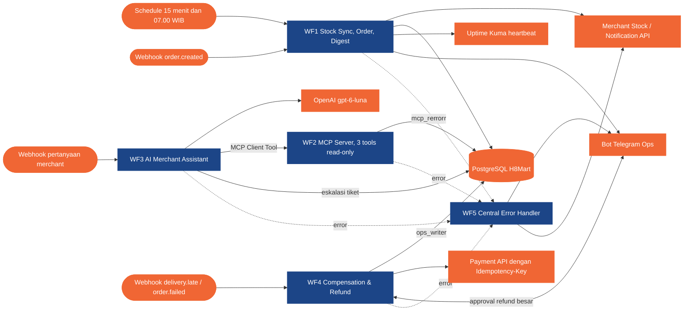

# 02 · Desain Solusi + Solution Fit + ROI · H8Mart Quick-Commerce Ops

**Nama:** Yusuf Baihaqi Amanda
**Workflow yang dibangun:** WF1 Stock Sync, Order Intake & Daily Digest; WF2 Merchant Data Tools (MCP Server); WF3 AI Merchant Assistant; WF4 Compensation & Refund; WF5 Central Error Handler.
**Basis dokumen:** skenario `README.md`, `guide/tasks.md`, template mentor, materi Lab Phase 3 W3D3–W3D4, serta catatan uji WF1–WF5 pada AWS. **Tanggal estimasi: 15 November 2026**.

## 1. Arsitektur 5 Workflow

**Deployment:** n8n self-hosted pada AWS EC2 (`t3.small`, ap-southeast-2/Sydney), Docker Compose dan Caddy HTTPS, PostgreSQL data H8Mart, Mock API, task runners, dan Uptime Kuma. URL publik menggunakan HTTPS. Kontainer saling mengakses melalui nama service (`postgres`, `mock-api`, `n8n`). Lima workflow telah Published; dua Schedule Trigger WF1 sengaja dinonaktifkan setelah evidence diambil sesuai `guide/submission.md` agar tidak membanjiri alert/digest. Alur order webhook tetap tersedia.

**Batas arsitektur:** WF2 hanya mengekspos tool SQL baca-saja dengan `mcp_reader`. WF3 masih menerima `merchant_id` dari request, sehingga pembatasan hasil SQL berdasarkan merchant **belum sama** dengan autentikasi dan otorisasi tenant per pengguna. Kontrol akses ini wajib ditingkatkan bila kelak memakai merchant riil.

## 2. Keputusan Pendekatan per Titik Keputusan (rule-based vs AI-driven)

| Kode | Pertanyaan yang diputuskan | Jenis data | Pendekatan (rule-based / AI / manusia) | Alasan |
| --- | --- | --- | --- | --- |
| **D1** | Apakah stok mencukupi dan event order valid? | Data terstruktur: `merchant_id`, SKU, quantity, row stok | **Rule-based** | Perbandingan jumlah dan validasi skema deterministik; tidak ada alasan memakai LLM. WF1 memberi 200/409/422 dan menjaga idempotensi. |
| **D2** | Apakah cancel rate atau SLA melampaui ambang tindakan? | Agregat terstruktur: total order, cancelled, SLA on-time | **Rule-based untuk keputusan; Ops untuk tindak lanjut** | Persentase dihitung dari SQL, bukan interpretasi AI. **Saat ini WF1 menghitung KPI dan mengirim digest; alert khusus threshold cancel/SLA belum terverifikasi sebagai node produksi.** Jadi ini rekomendasi pengembangan, bukan klaim uji PASS. |
| **D3** | Berapa voucher dan apakah refund membutuhkan persetujuan? | Event `delivery.late` / `order.failed`, minutes_late, payment_status, total_amount | **Rule-based + manusia untuk approval** | Aturan finansial harus dapat diaudit. Dalam ekspor WF4 yang tersedia: telat 1–15 menit → voucher Rp5.000; >15 menit → Rp10.000. Refund hanya jika pembayaran `captured`, nominal = `total_amount`; **> Rp50.000** menunggu approval Ops via Telegram. Cocokkan dengan JSON final AWS sebelum push. |
| **D4** | Mengapa order merchant banyak dibatalkan? | Pertanyaan bahasa alami + hasil tool MCP berisi KPI dan alasan cancel | **AI-assisted, grounded pada read-only MCP** | Pertanyaan terbuka perlu pemahaman bahasa, tetapi angka dan alasan harus berasal dari tiga tool PostgreSQL. AI tidak boleh mengarang diagnosis di luar data. |
| **D5** | Apakah jawaban AI layak dikirim langsung? | Structured JSON: `jawaban`, `data_dipakai`, `confidence`, `perlu_eskalasi` | **Rule-based guardrail + CS manusia bila gagal** | WF3 hanya menjawab ketika `confidence >= 0.8` dan `perlu_eskalasi == false`; sisanya membuat tiket `ops.tickets`. Jika LLM/error parser gagal, fallback mengarah ke eskalasi, bukan jawaban rekaan. |

**Pola solution fit dari Lab W3D4:** tidak menyerahkan stok, nominal refund, atau guardrail sepenuhnya kepada AI. Pemrosesan data terstruktur dikerjakan dengan SQL/Code/IF/Switch, reasoning berbasis bahasa hanya pada WF3, dan keputusan berisiko tetap membutuhkan persetujuan manusia. WF5 menangani error lintas workflow; pada HTTP/payment error, status tidak boleh diasumsikan sukses.

## 3. Estimasi ROI

**Tujuan estimasi:** ilustrasi *business case* untuk sistem fiktif, **bukan realisasi efisiensi yang sudah diukur**. Semua angka beban kerja, upah, kurs, dan waktu yang tidak tersedia dari seed dinyatakan sebagai **asumsi**. Skenario dasar memakai bulan 22 hari kerja. Efisiensi waktu berarti pengurangan pekerjaan manual, bukan otomatis penghematan gaji tunai.

| Komponen | Rumus / asumsi | Angka (skenario dasar) |
| --- | --- | ---: |
| Waktu manual per hari menyusun laporan Ops | **Asumsi** 30 menit × 22 hari | 11 jam/bulan |
| Waktu CS per pertanyaan merchant yang dapat dijawab otomatis | **Asumsi** 8 menit × 120 pertanyaan/bulan | 16 jam/bulan |
| Waktu finance/Ops per voucher atau refund manual | **Asumsi** 10 menit × 40 kasus/bulan | 6,67 jam/bulan |
| Total volume kasus | **Asumsi** 120 pertanyaan merchant + 40 kasus kompensasi per bulan; bukan angka transaksional hasil seed | 160 kasus/bulan |
| Biaya tenaga kerja | **Asumsi** Rp50.000/jam (biaya tenaga kerja efektif) | Rp50.000/jam |
| Penghematan waktu bruto | 11 + 16 + 6,67 | **33,67 jam/bulan** |
| Nilai bruto waktu yang dapat dialihkan | (11 + 16 + 40×10/60) × Rp50.000 | **Rp1.683.333/bulan** |
| Estimasi pemakaian LLM | **Asumsi** 120 pertanyaan × 1.500 input + 500 output token/pertanyaan | 180.000 input + 60.000 output token/bulan |
| Biaya LLM per bulan, `gpt-6-luna` | (180.000/1.000.000 × US$0,10) + (60.000/1.000.000 × US$0,50) | **US$0,048 ≈ Rp768/bulan** |
| Biaya platform bulanan | **Estimasi AWS berdasarkan TCO dokumen 03** US$30,302/bulan mencakup perkiraan AWS EC2+disk+overhead; angka rinci dan TCO tiga opsi pada dokumen 03 | **Rp484.832/bulan** |
| Kurs untuk simulasi | **Asumsi**, bukan kurs aktual pada hari ini | **Rp16.000/US$** |
| **Net benefit per bulan** | Rp1.683.333 − Rp484.832 − Rp768 | **Rp1.197.733/bulan** |
| Biaya implementasi awal | **Asumsi** 40 jam × Rp50.000/jam | **Rp2.000.000** |
| **Simple payback period** | Rp2.000.000 / Rp1.197.733 | **≈ 1,67 bulan** |
| **ROI tahun pertama (sederhana)** | ((12 × Rp1.197.733) − Rp2.000.000) / Rp2.000.000 × 100% | **≈ 618,64%** |

**Sumber harga LLM:** OpenAI API Pricing, harga `gpt-6-luna` Standard **US$0,10/1 juta token input dan US$0,50/1 juta token output**, diperiksa 15 November 2026: https://developers.openai.com/api/docs/pricing dan https://developers.openai.com/api/docs/models/gpt-6-luna . Token per panggilan di atas **belum berasal dari metrik eksekusi WF3** sehingga belum memenuhi bukti tambahan nilai penuh untuk estimasi token aktual. Angka bisa diperbarui jika token usage pada n8n Executions tersedia.

**Perhatian perhitungan:** angka ROI sengaja memakai estimasi bruto pengalihan waktu. Tidak menghitung beban kerja pengawasan Ops, biaya QA, incident handling, tambahan EBS snapshot, outbound traffic, pajak, atau perubahan harga. ROI yang dapat dipertanggungjawabkan membutuhkan baseline sebelum–sesudah dan konversi biaya berdasarkan tagihan AWS nyata. Biaya platform ditautkan sementara ke dokumen 03, yang harus menyatakan rincian dan sumber harga terbaru.

### Skenario sensitivitas dan risiko ROI

| Skenario | Dasar perhitungan | Net benefit per bulan | Implikasi |
| --- | --- | ---: | --- |
| **Dasar** | Semua pengalihan waktu sesuai ilustrasi; platform Rp484.832; LLM Rp768 | Rp1.197.733 | Payback 1,67 bulan |
| **Konservatif** | Hanya **50%** efisiensi waktu terwujud; platform dan LLM sama | **Rp356.067** | Payback sekitar **5,62 bulan** |
| **Terburuk yang diuji sebagai sensitivitas** | Hanya **20%** efisiensi waktu terwujud; biaya platform naik menjadi Rp600.000; biaya LLM tetap | **−Rp264.101** | Payback tidak tercapai; revisi desain atau scope diperlukan |

**Risiko 1 — volume/efisiensi tidak sesuai asumsi:** merchant tetap menghubungi CS untuk kasus rumit atau data stok belum terpercaya, sehingga menit yang dihemat lebih kecil. Mitigasi: ukur waktu kerja sebelum–sesudah, jumlah tiket otomatis dan eskalasi, serta deflection rate AI per merchant.

**Risiko 2 — biaya dan reliabilitas:** biaya AWS, pemakaian LLM, kegagalan API, dan approval manusia dapat melebihi asumsi. Mitigasi: AWS billing alert, budget token, monitoring Uptime Kuma, retry terbatas, dead-letter, dan review bulanan SLA/biaya.

## 4. Batas Automasi & Risiko

| Risiko | Dampak | Mitigasi di rancangan |
| --- | --- | --- |
| Stok merchant tidak sinkron atau API selalu 500 | Pesanan batal, konflik stok, laporan tidak akurat | Retry terkontrol per merchant, proses merchant lain tetap jalan, dead-letter, sinyal Kuma dan alert Telegram; jangan menandai keseluruhan sync sukses ketika ada kegagalan. |
| Refund double processing / status pembayaran ambigu | Kerugian finansial atau pembayaran ganda | Idempotency-Key sebelum pemanggilan Payment API, catat `ops.refund_actions`, approval manusia untuk refund besar, dead-letter dan rekonsiliasi manual jika Payment 503. |
| Halusinasi AI, salah tenant, atau prompt injection | Jawaban salah dan kebocoran data antarmerchant | Tiga tool MCP `mcp_reader` read-only, output parser, confidence guardrail, eskalasi CS; **tambahkan autentikasi identitas merchant di sisi server sebelum penggunaan riil**. |
| AI/LLM/Structured Parser gagal | Merchant tidak mendapatkan jawaban yang dapat dipercaya | Fallback ke tiket CS dan pesan terkendali, jangan membuat angka KPI rekaan. |
| Silent failure dan alarm fatigue | Gangguan tidak diketahui, atau tim Ops mengabaikan alert berulang | Heartbeat Kuma, monitoring durasi, Error Workflow terpusat, rate control; dua schedule dimatikan sementara sesuai petunjuk penilaian setelah bukti didapat. |
| Credential/endpoint diekspos | Penyalahgunaan API dan akses data | Secret hanya dalam n8n credentials / `.env` yang tidak di-commit, Header Auth webhook, pembatasan Security Group, sanitasi export dan screenshot, batasi MCP agar tidak dapat diakses publik. |

### Bukti dan keterbatasan

- **WF1:** pada uji AWS, 12 merchant diproses, M009 gagal dan masuk dead-letter, 11 sukses; 205 baris stok tanpa duplikasi setelah sinkron berulang; jalur order diuji untuk 200, 409, 422 dan idempotensi; digest Telegram tercatat. Lihat `evidence/wf1/`.
- **WF2–WF3:** ketiga tool MCP diperiksa untuk KPI, alasan batal, dan stok; WF3 menjawab kasus yang memiliki dasar data dan menulis `ops.tickets` untuk eskalasi. Fallback logic disimulasikan, bukan uji outage LLM sungguhan. Lihat `evidence/wf2/` dan `evidence/wf3/`.
- **WF4:** pengujian approve, reject, refund otomatis, duplikat dan kegagalan Payment API tercatat; **bukti voucher otomatis perlu dipastikan tersedia di `evidence/wf4/`** sesuai syarat mentor.
- **WF5:** Error Trigger terbukti mengirim Telegram dan Notification; dead-letter dan heartbeat Kuma diuji. **Bukti deteksi sync 0 baris dan alert durasi masih perlu dicocokkan satu per satu** terhadap `guide/submission.md`.
- **Belum memenuhi pembuktian nilai penuh:** chat merchant via Telegram Trigger, dev set 10 kasus dengan label aktual, token usage LLM aktual, serta otorisasi tenant end-to-end. Jangan mengklaim fitur tersebut sebagai sudah selesai.

**Rujukan internal:** `README.md` §1–§6, `guide/tasks.md`, `guide/submission.md`, `data-contract.md`, `workflows/` WF1–WF5, `docs/01-brd-process-map.md`, `evidence/`.
