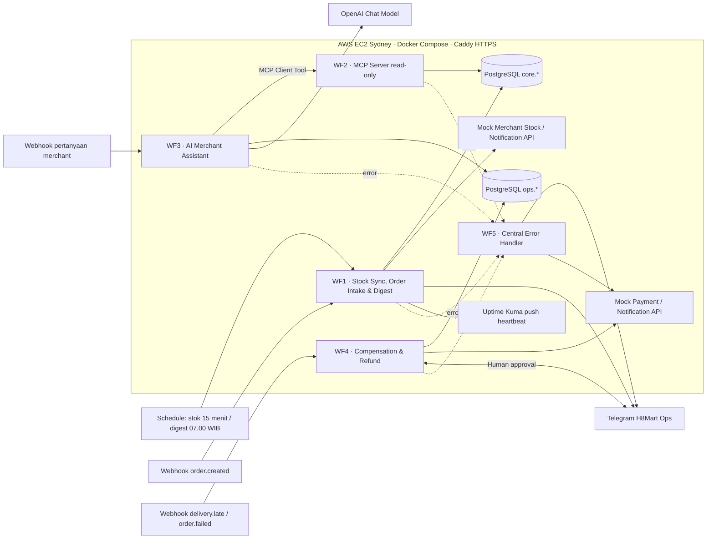

# H8Mart Quick-Commerce Ops · Yusuf Baihaqi Amanda

> Dokumen solusi untuk penilai Milestone Phase 3. **README.md di root repository adalah soal mentor dan tetap dipertahankan.** Dokumen ini menjelaskan implementasi dan pengujian yang dilaporkan, bukan jaminan kesiapan produksi komersial.
>
> **Penting untuk penilai:** lima workflow pada VPS AWS berstatus **Published**. Setelah bukti diambil dan stok berhasil disinkronkan, dua **Schedule Trigger** WF1 dinonaktifkan dan WF1 dipublish ulang sesuai `guide/submission.md` agar tidak terjadi banjir digest/alert. **Webhook WF1 tetap hidup**. Untuk smoke test, gunakan Production URL dan token yang diberikan secara privat melalui DM instruktur. Jangan mengambil token dari repository.

## 1. Ringkasan (3 kalimat)

H8Mart adalah simulasi quick-commerce dengan 12 merchant di tiga zona Jabodetabek; sistem ini mengotomasi sinkronisasi stok, validasi order, digest harian, layanan data merchant, kompensasi/refund, dan penanganan kegagalan melalui lima workflow n8n. Solusi berjalan pada AWS EC2 `t3.small` (region Sydney) dengan Docker Compose, PostgreSQL, mock Merchant Stock/Payment/Notification API, Caddy HTTPS, Uptime Kuma, Telegram, serta OpenAI dan MCP untuk asisten merchant. Alur inti sudah diuji di instance deployment, dengan idempotensi, dead-letter, approval manusia, guardrail AI, dan error alert; **chat merchant melalui Telegram belum dibuat** (WF3 menggunakan Webhook), dan readiness untuk pengguna riil masih bersyarat.

## 2. Arsitektur



**Akses:** `https://h8mart-yusuf.duckdns.org` meneruskan trafik HTTPS ke n8n melalui Caddy. PostgreSQL, mock API, dan endpoint MCP antar-workflow memakai nama service jaringan Docker; Uptime Kuma UI diperiksa melalui SSH port-forward, bukan URL publik. Diagram merangkum ketergantungan logis, bukan setiap node pada canvas. Model AI dan Telegram berada di luar VM.

## 3. Daftar Workflow

| Workflow | File export | Trigger | Fungsi satu kalimat |
| --- | --- | --- | --- |
| WF1 Stock Sync, Order Intake & Digest | `workflows/WF1-stock-sync-order-digest.json` | Schedule 15 menit (saat ini **deactivated**); Webhook `POST /webhook/order.created`; Schedule 07.00 WIB (saat ini **deactivated**) | Sinkron stok dengan retry/dead-letter dan upsert, validasi order 200/409/422 secara idempotent, lalu digest KPI/alert ke Telegram. |
| WF2 Merchant Data Tools | `workflows/WF2-merchant-data-tools.json` | MCP Server Trigger `/mcp/h8mart-merchant-tools` | Menyediakan tiga tool PostgreSQL **read-only** untuk KPI merchant, alasan pembatalan, dan status stok. |
| WF3 AI Merchant Assistant | `workflows/WF3-ai-merchant-assistant.json` | Webhook `POST /webhook/merchant-assistant` dengan Header Auth | Menjawab pertanyaan merchant memakai MCP tools, structured output, confidence guardrail, dan eskalasi tiket CS jika tidak aman/kurang yakin. |
| WF4 Compensation & Refund | `workflows/WF4-compensation-refund.json` | Webhook `POST /webhook/compensation-event` dengan Header Auth | Memberikan voucher keterlambatan, memproses refund idempotent, dan meminta approval Ops lewat Telegram untuk refund besar. |
| WF5 Central Error Handler | `workflows/WF5-central-error-handler.json` | Error Trigger dari WF1–WF4 | Mengirim alert kegagalan dengan business key ke Telegram dan mock Notification API. |

> **Pembatasan:** touchpoint Telegram yang sudah dipakai adalah digest (WF1), alert (WF5 dan beberapa cabang gagal), serta approval refund (WF4). **Tidak ada Telegram Trigger/allowlist untuk chat asisten WF3**, sehingga baris pengujian Telegram-chat dan penolakan `chat_id` asing dinyatakan *belum diuji/belum diimplementasikan*, bukan PASS. WF1 digest yang berjalan pada AWS akhir memakai query PostgreSQL langsung untuk alasan pembatalan (bukan klaim harus melewati WF2); jalur MCP agent WF3 → WF2 telah diuji.

## 4. Cara Menjalankan

### 4.1 Clone dan jalankan stack lokal

**Bash (macOS/Linux/Git Bash):**

```bash
git clone https://github.com/haqiamanda/milestone3-h8mart.git
cd milestone3-h8mart
cp .env.example .env
# Edit .env: ganti semua password/token default latihan dengan nilai lokal yang aman.
docker compose up -d
docker compose ps
```

**PowerShell 7:**

```powershell
git clone https://github.com/haqiamanda/milestone3-h8mart.git
Set-Location .\milestone3-h8mart
Copy-Item .env.example .env
# Edit .env: ganti semua password/token default latihan dengan nilai lokal yang aman.
docker compose up -d
docker compose ps
```

Prasyarat: Docker Compose v2.24+, RAM bebas minimal 6 GB; ikuti `SETUP.md` untuk versi image dan urutan setup. Default lokal: n8n `http://localhost:5690`, mock API port `8080`, PostgreSQL host port `5440`, Uptime Kuma `http://localhost:3011`. **Seed PostgreSQL otomatis hanya saat volume baru pertama kali diinisialisasi**. Jangan menggunakan `docker compose down -v` pada VPS production karena menghapus volume/data.

**Verifikasi awal DB dan mock:**

```bash
docker compose exec -T postgres psql -U h8mart -d h8mart -At -c "SELECT (SELECT count(*) FROM core.merchants), (SELECT count(*) FROM core.products), (SELECT count(*) FROM core.merchant_stock)"
curl -fsS http://localhost:8080/health
```

**PowerShell 7 (setara):**

```powershell
docker compose exec -T postgres psql -U h8mart -d h8mart -At -c 'SELECT (SELECT count(*) FROM core.merchants), (SELECT count(*) FROM core.products), (SELECT count(*) FROM core.merchant_stock)'
Invoke-RestMethod http://localhost:8080/health
```

Hasil seed yang diharapkan menurut `SETUP.md`: **12 merchant, 30 produk, 205 baris stok**. Hasil sinkron berikutnya tetap mempertahankan jumlah baris stok tersebut; pengujian tidak boleh sekadar mengandalkan jumlah tanpa memastikan `product_id` sesuai katalog.

### 4.2 Import workflow dan mapping credential

1. Buka n8n lokal, buat owner account, lalu **Import from File** untuk lima JSON pada `workflows/` (atau gunakan CLI import sesuai panduan n8n jika sesuai lingkungan). Workflow hasil import **tidak otomatis siap menerima trafik**, karena export public disanitasi.
2. Buat dan pilih ulang credential berikut **di n8n Credentials** (jangan isi secret di node, dokumentasi, atau GitHub):

   | Kebutuhan | Akses / referensi |
   | --- | --- |
   | PostgreSQL read-only | Host `postgres`, port `5432`, DB `h8mart`, user `mcp_reader` untuk WF2 dan operasi baca yang sesuai |
   | PostgreSQL write | Host `postgres`, port `5432`, DB `h8mart`, user `ops_writer` untuk penulisan `ops.*` |
   | Mock API | Header Auth `X-Api-Key` di HTTP Request yang mengarah ke `mock-api:8080` |
   | Webhook | Header Auth `X-H8Mart-Token` pada WF1, WF3, dan WF4 |
   | Telegram | Telegram API credential berisi token bot dari @BotFather; lakukan `/start` pada bot sebelum mengirim pesan |
   | AI | OpenAI API credential pada `OpenAI Chat Model`, dengan model yang tersedia pada akun |

3. Ganti placeholder push Uptime Kuma pada node `Heartbeat Uptime Kuma` dengan **token baru** dari monitor Push Uptime Kuma milik lingkungan Anda; jangan membagikan URL push bertoken. Buat/pilih `chat_id` Ops milik Anda pada node Telegram yang relevan. Untuk approval Telegram via *Send and Wait for Response*, gunakan HTTPS yang dapat menerima callback/resume (lihat `SETUP.md` dan `guide/telegram-bot.md`).
4. Cek URL antar-container: MCP WF3 ke `http://n8n:5678/mcp/h8mart-merchant-tools`, mock API ke `http://mock-api:8080`, dan DB host `postgres`. **Import WF5 terlebih dahulu**, kemudian WF2, WF1, WF3, WF4; setelah itu **set Error Workflow WF1–WF4 ke WF5 yang baru** (ID workflow dari AWS tidak portable dan link error handler wajib diverifikasi).
5. Periksa node disabled, kredensial, respons webhook dan koneksi terlebih dahulu; Publish WF2 sebelum menguji WF3. Jalankan sinkron awal sekali agar data stok terkini. Untuk **instance penilaian yang sudah berjalan di AWS**, jangan mengaktifkan kembali kedua Schedule WF1 tanpa instruksi mentor.

**Bot Telegram:** buat lewat @BotFather (`/newbot`), simpan token hanya di Credential Telegram API n8n, kirim `/start`, ambil `chat_id` sendiri melalui @userinfobot, dan test satu pesan dari node Telegram. Username bot untuk penilai disampaikan lewat **DM**, bukan token bot. Integrasi chat asisten Telegram dan mapping allowlist `ops.telegram_merchants` belum ada dalam implementasi ini.

### 4.3 Jalankan di VPS yang tersedia

Pada VPS proyek, gunakan file `compose.yaml` bersama override `compose.vps.yaml` dan `.env` privat yang sudah dikonfigurasi untuk domain, HTTPS, password, dan encryption key. **Jangan menyalin `.env` VPS ke GitHub**; perubahan `N8N_ENCRYPTION_KEY` setelah credential dibuat dapat membuat credential tidak terbaca.

```bash
docker compose -f compose.yaml -f compose.vps.yaml ps
```

Untuk reproduksi deployment dari nol, ikuti `SETUP.md` bagian **7. Deploy ke VPS**, termasuk DNS DuckDNS, Caddy, firewall/Security Group, TLS, serta pemulihan backup bila ada. Instance saat ini sudah disiapkan; **jangan melakukan reset volume atau recreate stack sekadar untuk menguji README**.

## 5. Cara Memverifikasi (untuk penilai)

**Base URL:** `https://h8mart-yusuf.duckdns.org`. **Semua URL dan payload pada contoh di bawah harus menggunakan credential penilaian yang dikirim melalui DM privat**. Produksi n8n menggunakan path `/webhook/...`, bukan `/webhook-test/...`. Penilai tidak mempunyai akses langsung ke database, mock API, editor n8n, atau Uptime Kuma; pengecekan SQL/Executions/Kuma dibuktikan melalui screenshot dalam repo.

**Bash / Git Bash (contoh WF1):**

```bash
export H8MART_BASE_URL='https://h8mart-yusuf.duckdns.org'
read -r -s -p 'Token penilaian: ' H8MART_TOKEN; echo
curl -i -X POST "$H8MART_BASE_URL/webhook/order.created" \
  -H "X-H8Mart-Token: $H8MART_TOKEN" \
  -H 'Content-Type: application/json' \
  --data-binary @fixtures/event-order-created-ok.json
```

**PowerShell 7 (contoh WF1):**

```powershell
$baseUrl = 'https://h8mart-yusuf.duckdns.org'
$secret = Read-Host 'Token penilaian' -AsSecureString
$token = [System.Net.NetworkCredential]::new('', $secret).Password
Invoke-WebRequest -Method Post -Uri "$baseUrl/webhook/order.created" `
  -Headers @{ 'X-H8Mart-Token' = $token } `
  -ContentType 'application/json' -InFile .\fixtures\event-order-created-ok.json
Remove-Variable token, secret
```

> Untuk HTTP 409/422, `Invoke-WebRequest` PowerShell bisa melempar exception/menampilkan error; periksa `StatusCode`/body, bukan menganggap hasil 409 berarti workflow rusak. Jangan masukkan token ke command yang akan direkam screenshot atau dibagikan publik. Pada PowerShell, perintah di atas juga menyimpan token sementara dalam variabel sesi sampai dihapus; hindari merekam terminal.

| Skenario | Perintah / aksi | Hasil yang terlihat | Bukti / batasan |
| --- | --- | --- | --- |
| Sinkron stok: retry, dead-letter, stok habis terdeteksi | Di VPS jalankan WF1 stok lewat eksekusi terkontrol; bandingkan dua eksekusi, output `Gabungkan Katalog`, `core.merchant_stock`, dan log Merchant Stock API | Jumlah stok tetap **205** setelah dua sinkron, merchant gagal permanen M009 masuk dead-letter, merchant lain diproses, penambahan stok habis terdeteksi | `evidence/wf1/`; **log retry fail→success `/admin/stock-calls` perlu dicocokkan** dengan screenshot submission |
| Order ditolak saat stok habis, event ganda tidak membuat order ganda | POST fixture `event-order-created-ok.json`, `event-order-created-stok-habis.json`; kirim ulang event dengan `order_id` sama | HTTP **200** untuk stok cukup, **409** untuk stok habis, **422** untuk event tidak valid; order duplikat tidak menambah baris baru | `evidence/wf1/`; lihat response dan catatan DB di evidence |
| Digest harian cocok dengan SQL | Lihat Executions WF1 digest dan hasil query independen berdasarkan `core.data_info.hari_data_terakhir` | Telegram menerima KPI yang sesuai SQL; contoh hasil pengujian: 162 orders, 17 canceled, SLA 82,84% untuk tanggal data terakhir (jangan gunakan jam server sebagai tanggal dataset) | `evidence/wf1/`; Schedule 07.00 nonaktif sesuai instruksi submission |
| MCP tool dipanggil deterministik dan oleh agent | Lihat WF2 MCP Server serta Executions WF3 → `MCP Tools Merchant`; panggil `tools/list` dan `tools/call` di lingkungan internal yang terautentikasi/terkontrol | Tiga tools read-only: KPI, alasan batal, stok; query `mcp_reader` tidak dapat INSERT | `evidence/wf2/`, `evidence/wf3/`; **jalur MCP Client deterministik dari WF1 belum terbukti pada workflow final** |
| Asisten AI: jawaban dari data, eskalasi, injeksi, fallback | POST payload merchant (`merchant_id`, `question`) ke `/webhook/merchant-assistant`; gunakan `fixtures/dev-set-asisten.json` dan `question-catatan-injeksi.json` pada lingkungan pengujian | Jawaban `jawaban`, `data_dipakai`, `confidence`, `perlu_eskalasi` diproses guardrail; jika ragu/unsupported dibuat tiket CS | `evidence/wf3/`; fallback pernah diuji melalui workflow TEST terpisah, **bukan bukti gagal provider secara live**; 10-case report perlu diverifikasi |
| Voucher/refund otomatis vs approval Ops; sekali walau event ganda | POST fixtures `event-delivery-late-ringan.json`, `event-order-failed-kecil.json`, `event-order-failed-besar.json` ke `/webhook/compensation-event`; untuk besar, lakukan approve/reject dari Telegram | Voucher otomatis, refund kecil otomatis, refund besar pending lalu disetujui/ditolak; idempotency mencegah pembayaran ganda | `evidence/wf4/`; pengujian approve, reject, duplicate, dan Payment 503 telah dilaporkan |
| Kegagalan disengaja → retry → dead-letter → alert business key | Periksa uji merchant M009 atau Payment API 503 dan Error Workflow WF5 | `ops.dead_letter` bertambah sesuai skenario, alert Telegram berisi identitas bisnis terkait, status pembayaran tidak dipalsukan sukses | `evidence/wf1/`, `evidence/wf4/`, `evidence/wf5/` |
| Heartbeat Up/Down, sinkron 0 baris, ambang durasi | Lihat node `Heartbeat Uptime Kuma` dan screenshot monitor; periksa skenario outage stok dan kondisi lambat di Executions | Push `up`/`down` menggambarkan hasil sinkron sesuai kondisi; silent failure/durasi menghasilkan alert pada skenario yang didukung | `evidence/wf1/`, `evidence/wf5/`, `evidence/deploy/04-uptime-kuma.png`; **bukti setiap subkasus perlu dicocokkan** |
| Bot Telegram: digest pagi, alert, tombol approval, chat asisten dan penolakan `chat_id` asing | Lihat screenshot Telegram untuk WF1 digest, WF4 approval, WF5 alert; fitur chat bot merchant dicek berdasarkan ada/tidaknya Telegram Trigger | Tiga touchpoint pertama telah diuji; **chat merchant via Telegram dan foreign `chat_id` rejection: belum diimplementasikan** | `evidence/wf1/`, `evidence/wf4/`, `evidence/wf5/`; tidak mengklaim nilai penuh untuk chat |

**Contoh pemanggilan WF3/WF4:** Pada Bash/Git Bash gunakan `curl` dengan header yang sama seperti contoh WF1, ganti URL menjadi `/webhook/merchant-assistant` atau `/webhook/compensation-event`, dan gunakan payload dari `fixtures/` yang sesuai. Pada PowerShell gunakan `Invoke-WebRequest -Method Post` dengan `-InFile` serta header yang sama; contoh lengkap pola ada pada bagian ini. Gunakan **order ID baru** ketika ingin menguji create/refund baru; event yang identik memang dirancang mengembalikan status idempotent.

**Kendali smoke test:** smoke test di Production URL mengubah state database; hindari mengulang event pembayaran tanpa kebutuhan, catat `order_id`, dan jangan melakukan reset dataset produksi penilaian. Penilai hanya perlu menguji lima skenario di `guide/submission.md` (dua order, dua pertanyaan WF3, satu delivery.late, satu order.failed besar), bukan mengulang seluruh rangkaian pengujian internal.

## 6. Keputusan Desain & Batasan

| Keputusan / trade-off | Alasan dan implikasi |
| --- | --- |
| Rule-based untuk stok, refund policy, idempotency, dan ambang keputusan | Keputusan deterministik lebih mudah diaudit; AI tidak menentukan besaran refund atau status pembayaran. |
| AI hanya untuk pertanyaan merchant berbasis data | Agent memakai MCP read-only tools, structured parser, threshold confidence ≥0,8 dan eskalasi jika tidak cukup bukti; tidak mengarang angka bila data/tool gagal. |
| Approval manusia untuk refund besar | Menahan pembayaran hingga Ops mengizinkan; Telegram Send and Wait/Wait node membutuhkan HTTPS dan state resume yang benar. |
| Dead-letter + WF5 + Kuma | Error harus terlihat, dengan business key dan jejak peristiwa; tidak semua kegagalan dapat diatasi otomatis. Merchant M009 sengaja gagal untuk pengujian. |
| Schedule WF1 dimatikan setelah evidence | Mengikuti `guide/submission.md` agar penilaian tidak dibanjiri digest/alert; data sinkron tetap tersimpan, tetapi **monitoring berkala tidak aktif** selama schedule off. |
| Credential dihapus dari export publik | Melindungi ID dan secret n8n; **pembaca harus memasang credential ulang**. Nama credential dalam export yang diminta mentor belum dipertahankan dan harus diaudit sebelum submission. Placeholder push Kuma saat export awal perlu diselaraskan ke **`ISI_TOKEN_PUSH_KUMA`** sebelum GitHub push. |
| Pengikatan identitas merchant belum kuat | WF3 menerima `merchant_id` dari payload dan menggunakan Header Auth bersama. Token bersama **bukan autentikasi per merchant**; tidak cocok untuk multi-tenant publik tanpa identitas yang divalidasi server dan filter tenant wajib. |
| Telegram chat merchant belum dibuat | Nilai penuh pada integrasi Telegram-chat dan allowlist penolakan foreign chat tidak diklaim; hanya webhook AI tersedia. |
| Komponen pada satu EC2 | Cocok untuk lab/smoke test, bukan HA; backup, restore, observabilitas host, pengetesan beban, billing alert, dan audit Security Group diperlukan sebelum penggunaan riil. |
| Data berbasis seed sintetis | `core.data_info` menentukan tanggal dataset; mock API dan dataset tidak mewakili SLA, volume, atau perilaku provider nyata. |

**Status readiness:** *siap untuk demo dan penilaian terkontrol dengan persyaratan*, belum dinyatakan siap untuk produksi merchant/pelanggan riil. Lihat `docs/01-brd-process-map.md` (BRD), `docs/02-desain-solusi-roi.md` (keputusan/ROI), `docs/03-tco-deployment.md` (estimasi TCO), dan `docs/04-readiness-checklist.md` (gap dan kontrol).

## 7. Struktur Repo

```text
milestone3-h8mart/
├── .env.example                 # nilai contoh latihan, bukan rahasia production
├── .gitignore
├── README.md                    # soal mentor (tidak diubah)
├── SETUP.md                     # instruksi setup mentor (tidak diubah)
├── data-contract.md
├── compose.yaml
├── compose.vps.yaml
├── Caddyfile
├── guide/                       # rubric, tugas per WF, submission
├── mock-api/
├── seed/
├── fixtures/
├── assets/
├── workflows/
│   ├── README.md
│   ├── WF1-stock-sync-order-digest.json
│   ├── WF2-merchant-data-tools.json
│   ├── WF3-ai-merchant-assistant.json
│   ├── WF4-compensation-refund.json
│   └── WF5-central-error-handler.json
├── docs/
│   ├── 01-brd-process-map.md
│   ├── 02-desain-solusi-roi.md
│   ├── 03-tco-deployment.md
│   ├── 04-readiness-checklist.md
│   └── 05-readme-solusi.md
└── evidence/
    ├── wf1/
    ├── wf2/
    ├── wf3/
    ├── wf4/
    ├── wf5/
    └── deploy/
```

**Tidak disertakan dalam GitHub:** `.env`, `.pem`, backup privat, file export AWS mentah, token Header Auth, push token Uptime Kuma asli, token Telegram, OpenAI API key, serta screenshot yang mengandung informasi sensitif. Akses smoke test dan token penilaian dikirim **hanya via DM instruktur**, mengikuti `guide/submission.md`.
